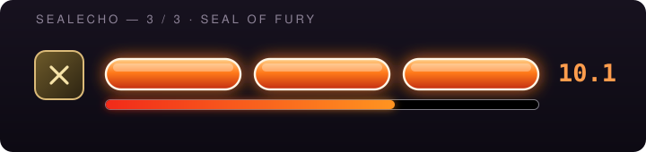

# SealEcho

A three-slot bar for **Unsealed Wrath** echo stacks on **WoW: Forever** — showing how many
charges you hold, how long they last, and which Seal they came from.

It stays readable **in combat**, which is the whole point: on 12.0+ clients every aura field
(`name`, `spellId`, `applications`, `duration`) becomes *secret* the moment you enter combat, so
the usual "read the aura and draw it" addon never shows anything when it matters.




<sub>Three stacks of Echo of Fury: each slot lit and pulsing in the Seal's colour, the countdown
strip draining underneath.</sub>

---

## What it shows

- **Three slots** that light up one at a time as echo stacks build (1 → 2 → 3).
- **Seal colour** — fill, outline and glow are tinted by the Seal you are actually holding.
- **A soft per-slot pulse** that spills past the bar, so a full stack is visible in your periphery.
- **A thin timer strip** under the slots that drains and shifts orange → red as it runs out.
- **The Seal's icon** on the left, drawn by the game itself.

## Install

1. Download the latest release (or clone this repo).
2. Drop the `SealEcho` folder into `World of Warcraft\_forever_\Interface\AddOns\`.
3. Restart the client (a `/reload` is enough after updates).

## First run — teach it your echoes

The addon filters auras by spell ID, and it learns those IDs by name while they are readable.
Echo names are only readable **outside combat**, so:

1. Put a Seal up and hit something.
2. **Leave combat** — the echo lingers ~15 s and is picked up automatically
   (`SealEcho: learned Echo of Righteousness (spell …)`).
3. Repeat once per Seal you actually play. After that it works in every fight.

`/se status` tells you what it knows and whether the aura container is alive.

## Slash commands

| Command | What it does |
| --- | --- |
| `/se` | open the options panel |
| `/se lock` · `/se unlock` | lock / unlock the bar (unlocked = drag it) |
| `/se learn` | learn echo spell IDs now (out of combat) |
| `/se status` | learned echoes, aura-container state, last error |
| `/se rebuild` | rebuild the aura container (out of combat) |

## Options

Esc → Options → AddOns → SealEcho, or `/se`.

- **Position** — lock, drag, or right-click the minimap icon.
- **Visibility** — Always · In combat only · Only with an active echo · Never.
- **Display** — Seal icon, countdown seconds, pulse glow, minimap icon.
- **Size** — width, slot height, gap, scale.
- **Seal colours** — an **RGB picker per Seal** for its fill and glow colour.
- **Preview (5s)** shows the bar for five seconds; **Reset to defaults** restores every setting
  and keeps the echoes you have already learned.

## How it works (for addon authors)

On 12.0+ you cannot read aura state in combat — `C_UnitAuras.GetAuraDataByIndex` throws, and
`GetPlayerAuraBySpellID` simply returns `nil`. SealEcho therefore never reads anything. It builds a
`CustomAuraContainerTemplate` aura container and hands the engine its own widgets:

```lua
button:SetIcon(texture)
button:SetApplicationBar(bar, { minApplications = i, maxApplications = 3 })
button:SetDurationBar(bar, { direction = Enum.StatusBarTimerDirection.RemainingTime })
button:SetDurationText(fontString, { textFormatter = …, textColor = { curve = …, property = … } })
```

`SetApplicationBar` is the useful trick: the engine calls `SetMinMaxValues(0, max)`,
`SetValue(stacks)` and `SetShown(stacks >= min)` on your bar. Giving each of the three slots its own
aura slot with `min = 1 / 2 / 3` makes them light up one by one, with no Lua ever touching the
stack count. The countdown colour comes from a `C_CurveUtil` colour curve the engine evaluates.

The container must be created **outside combat**; after that it keeps rendering on its own.

## Localisation

English is the base language and also the lookup key, so untranslated strings fall back to English
automatically. `Locale.lua` ships deDE, frFR, esES/esMX, itIT, ptBR and ruRU. To add a language,
append a table keyed by the WoW locale code — partial translations are fine.

## Credits

- [`colbyrobins-wow-forever-addons/pally-seal-cooldowns`](https://github.com/colbyrobins-wow-forever-addons/pally-seal-cooldowns)
  — the working aura-container pattern and the Forever seal spell IDs.
- [`Hackblarvest/EverAuras`](https://github.com/Hackblarvest/EverAuras) — secret-value handling and
  the engine-driven rendering approach.

## License

MIT — see [LICENSE](LICENSE).
